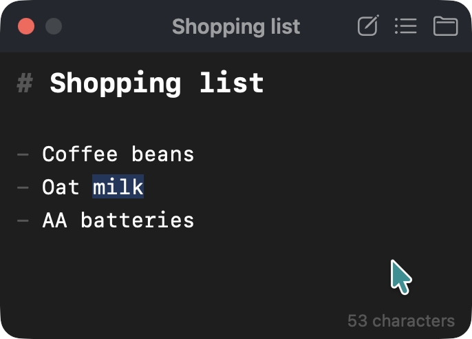

# notepanel

[English](README.md) | 日本語

macOS 用の、ほかのウインドウの上に浮かぶメモ帳。どのアプリにいても（フルスクリーンでも）`Ctrl+Cmd+N` を押すと、その上にノートのパネルが出る。VS Code のように編集し、もう一度 `Ctrl+Cmd+N`（または `Cmd+W`、`Esc`）を押すと、使っていたアプリに戻る。

ノートは、選んだフォルダに置く普通の Markdown ファイル。ほかのエディタで開いたり、好きな方法で同期やバックアップをしたりもできる。



## 特徴

- **何の上にでも出る。** パネルはほかのウインドウの上に浮かび、フルスクリーンのアプリの上にも、どのスペースにも出る。パネルを出してもアプリは切り替わらない。使っていたアプリはアクティブのままで、パネルを隠すとフォーカスが戻る。
- **小さくて軽い。** アプリはおよそ 2 MB。
- **VS Code のように編集できる。** エディタは CodeMirror 6 で、キー操作は VS Code に合わせている。複数カーソル、矩形選択、行の移動とコピー、検索と置換が使える。Markdown の色分け、`Return` でのリストの継続、`Cmd+B` や `Cmd+I` などによる太字や斜体の付け外しもできる。
- **普通のファイル。** ノートは 1 つずつ `.md` ファイルになり、ファイル名は 1 行目から付く。
- **文章を失いにくい。** 入力しながら保存し、ほかのアプリが変えたファイルは上書きせず、ノートごとに以前の版を残す。以前の版は `Cmd+Y` で見られる。
- **ノートをすばやく切り替えられる。** `Cmd+P` でノートの名前と本文を検索し、`Ctrl+Tab` で次のノートへ移る。ピン留めしたノートは、決めた順で先頭に並び、`Cmd+1`〜`Cmd+9` で開く。

## インストール

macOS 14 Sonoma 以降が必要。[Homebrew](https://brew.sh) でインストールする。

```sh
brew install kkensuke/tap/notepanel
open /Applications/notepanel.app
```

アプリは ad hoc 署名で、Apple の公証を受けていないため、そのままでは macOS が開くのを拒む。Homebrew がインストール後に quarantine 属性を外す。

notepanel はメニューバーにノートのアイコンとして常駐し、Dock にはアイコンを出さない。ショートカットにアクセシビリティの許可は要らない。ログイン時に起動するには、設定画面で **Open at login** をオンにする。

更新するには、`brew upgrade notepanel` を実行する。先に notepanel を終了するので、更新後にもう一度開く。

### 自分でビルドする

Swift 5.10 以降が必要。Xcode は要らず、Command Line Tools（`xcode-select --install`）で足りる。

```sh
git clone https://github.com/kkensuke/notepanel.git
cd notepanel
scripts/bundle.sh                         # build/notepanel.app を作る
cp -R build/notepanel.app /Applications/
open /Applications/notepanel.app
```

更新するには、`git pull` と `scripts/bundle.sh` をもう一度実行し、notepanel を終了して（パネルで `Cmd+Q`）、新しいアプリを `/Applications` にコピーしてから開く。

## 使い方

- **表示と非表示。** `Ctrl+Cmd+N` を押すか、メニューバーのアイコンをクリックする。`Esc` か `Cmd+W` でパネルを隠す。
- **ノート。** `Cmd+N` で新しいノートを作る。`Cmd+P` で切替画面を開き、文字を入力して検索し、`Return` でノートを開く。本文で見つかったノートは、一致した箇所を選んだ状態で開く。各行には、ピン留めのボタンとゴミ箱のボタンがある。
- **以前の版。** `Cmd+Y` で、ノートの以前の版を新しい順に一覧し、選んだ版の本文を下に表示する。`Return` か行のボタンで、その版の全文をコピーする。一部をコピーするには、その部分を選んで `Cmd+C` を押す。ここでノートが変わることはない。ある版に戻すには、その版をコピーし、`Esc` で戻ってから、ノートに貼り付けて置き換える。
- **ピン留め。** ピン留めしたノートは、切替画面でも、`Ctrl+Tab` で順に移るときも先頭に来る。順番を変えるには、検索欄が空のときに、行の左端のつまみをドラッグするか、`Option+Up` と `Option+Down` を押す。`Cmd+1`〜`Cmd+9` で 1〜9 番目のピン留めを開く。切替画面では、ピンの横にそれぞれのキーを表示する。
- **名前。** ノートの名前は 1 行目から付く。たとえば `# Shopping list` は `Shopping list.md` として保存する。同じ名前のノートがあれば、番号を足す。自分で名前を決めるには、タイトルバーの名前をクリックする。それ以降は、決めた名前のまま変わらない。
- **リンク。** リンクは、Cmd を押しながらクリックすると開く。リンクにポインタを載せると、最初の数文字の上に 2 つのボタンが出る。1 つはリンクを開き、もう 1 つは URL をコピーする。
- **タスク。** タスク（`- [ ]` か `- [x]`）の箱をクリックすると、チェックを付けたり外したりできる。箱は文字のままで、`Cmd+Z` で取り消せる。
- **ファイルのドロップ。** Markdown ファイルなどのテキストファイルをノートにドロップすると、ドロップした位置にその文章を挿入する。ファイル自体は開かず、変更もしない。複数のファイルは別々の行に入り、テキストでないファイルは飛ばす。`Cmd+Z` で取り消せる。
- **メニュー。** メニューバーのアイコンを右クリック（または Control クリック）すると、New Note、Search Notes、Settings、Keyboard Shortcuts、履歴のフォルダ、Quit が出る。各項目には、パネルで同じことをするキーを表示する。
- **キー操作。** パネルで `Shift+Cmd+/` を押すと、キー操作の一覧が出る。一覧は、設定画面の Shortcuts タブと、メニューバーのアイコンのメニューからも開ける。
- **大きさ。** パネルは、決めた大きさのまま変わらない。`Cmd+Plus` と `Cmd+Minus` でノートの文字の大きさを変え、`Cmd+0` で元に戻す。
- **既定の位置。** `Ctrl+Cmd+M` で、マウスポインタのあるディスプレイの既定の位置と大きさにパネルを移す。画面の外に出てしまったパネルを呼び戻すのにも使える。パネルを動かす前にもう一度押すと、元の位置に戻る。既定はディスプレイごとに持つ。標準の既定は、パネルを初めて開いたときの大きさで、ディスプレイの中央に置く。自分で決めるには、そのディスプレイの好きな位置にパネルを置き、設定画面で **Use Current** をクリックする。

## 設定

パネルで `Cmd+,` を押すか、メニューバーのアイコンのメニューから設定画面を開く。

- **General：** データフォルダ（ノートとその履歴を入れるフォルダ）、履歴を残す期間、パネルがあるディスプレイでの既定の位置と大きさ（`Ctrl+Cmd+M` 用。**Reset** で標準に戻す）、ノートのフォント（この Mac の等幅フォントから選ぶ）、表示の文字の大きさ、パネルの背景の不透明度、空白・タブ・全角空白を表示するかどうか、Tab キーで入れる空白の数（2 か 4）、メニューバーのアイコンを表示するかどうか、Open at login。背景の不透明度のスライダーは、中央が既定の半透明の背景で、スライダーの下の短い印がその位置を示す。左に動かすとパネルの後ろがよく見え、右に動かすと背景が不透明になる。文字は変わらない。
- **Shortcuts：** どのアプリからでも使えるショートカット（ノートの表示・非表示、新しいノート、ノートの検索）と、パネルの中で使えるショートカット（次のノート、前のノート、既定の位置）。ショートカットをクリックしてから、キーを押す。`Esc` で取り消し、× ボタンでショートカットを外す。文字の入力に使うキーを取らないように、どのアプリからでも使えるショートカットには Control か Option、または Shift と Command が、パネルの中で使えるショートカットには Command か Control が要る。ほかのショートカットやパネルがすでに使っているキーは受け付けず、その理由を欄に表示する。

メニューバーのアイコンを隠しても、設定画面は開ける。パネルで `Cmd+,` を押すか、Finder や Spotlight から notepanel をもう一度開く。

## ノートの置き場所と安全性

- **置き場所。** ノートは、notepanel のデータフォルダの中の `Notes` フォルダに置く。データフォルダは、設定で別のフォルダ（同期するフォルダなど）を選ばない限り `~/Library/Application Support/notepanel` である。notepanel が一覧に出すのは、`Notes` の直下にある `.md` ファイルだけで、サブフォルダの中のファイルは出さない。別のデータフォルダを選んでも、ノートは移動しない。ノートは、そのフォルダの `Notes` に移す。
- **保存。** 入力をやめてから 0.3 秒たつと保存する。パネルを隠したとき、ノートを切り替えたとき、終了するときは、すぐに保存する。ノート名の左のアイコンは、未保存のあいだは点線の丸、保存し終えるとチェック入りの丸になる。保存に失敗すると、アイコンが赤い警告になり、パネルの下部に理由を表示する。文章は notepanel に残り、終了するときは、文章を捨てる前に確認する。
- **ほかのアプリによる変更。** notepanel は、パネルを出したときと、ノートを開いたときに、ノートを読み直す。未保存の文章があるあいだにディスク上のファイルが変わっていたら、文章は `… (conflict 日付 時刻).md` という別のファイルに保存し、ディスク上のファイルには手を付けない。
- **履歴。** 保存でノートを置き換える前に、以前の文章を版として、データフォルダの `History` の中の、ノートと同じ名前のフォルダに残す。残すのは、ノートごとに多くても 10 分に 1 回。直近 1 時間の版はすべて残し、それより古い版は、1 日分は 1 時間ごと、1 週間分は 1 日ごと、それ以降は 1 週間ごとに、いちばん新しいものだけを残す。1 週間ごとの版は、無期限に残すか、1 年で消すかを設定で選べる。notepanel がノートの名前を変えると、履歴もついていく。ゴミ箱に入れたノートの履歴は、そのまま残る。もう存在しないノートと同じ名前を新しいノートが使うと、古い履歴の名前を `… (old 日付 時刻)` に変える。版は、日付と時刻を名前にした普通のテキストファイルである。
- **削除。** ノートをゴミ箱に入れる前に確認する。ゴミ箱に入れたノートは、Finder で元に戻せる。
- **ほかのファイル。** UTF-8 のテキストでないファイルは開かず、変更もしない。

## キー操作

この一覧は、notepanel でも表示できる。パネルで `Shift+Cmd+/` を押す。

パネル、設定画面、キー操作の一覧で：

| キー | 動作 |
|---|---|
| ⌘, / ⇧⌘/ | 設定画面 / キー操作の一覧を開く、閉じる |
| ⌘Q | 終了する（先に保存し、保存できないものがあれば確認する） |

パネルで：

| キー | 動作 |
|---|---|
| ⌘N / ⌘P / ⌘O | 新しいノート / ノートの切り替え / このノートを選んだ状態でノートのフォルダを開く |
| ⌘Y | このノートの以前の版 |
| ⌃Tab / ⌃⇧Tab | 次 / 前のノート。ピン留めしたノートが先（設定で変えられる） |
| ⌘1 … ⌘9 | 1 … 9 番目のピン留めを開く |
| ⌘+ / ⌘− / ⌘0 | ノートの文字を大きく / 小さく / 既定の大きさに |
| ⌃⌘M | パネルを、ポインタのあるディスプレイの既定の位置と大きさに移す。もう一度押すと元に戻す（設定で変えられる） |
| ⌘W、Esc | 隠す（Esc は、検索、追加したカーソル、切替画面、以前の版があれば先にそれを閉じる） |
| 切替画面で ↑↓、Return、⌘⌫ | 選ぶ、開く、ゴミ箱に入れる |
| 切替画面で ⌥↑ / ⌥↓ | ピン留めしたノートを上 / 下へ動かす（検索欄が空のとき） |
| 以前の版で ↑↓、Return、⌘A、⌘C | 選ぶ、全文をコピーする、全文を選択する、選んだ部分をコピーする |

編集：

| キー | 動作 |
|---|---|
| ⌘⌫ | 行頭まで削除する。行頭では、前の行とつなげる |
| ⌘← / ⌘→ | 行頭（最初はインデントの後ろ）/ 行末 |
| ⌥↑ / ⌥↓、⇧⌥↑ / ⇧⌥↓ | 行を移動、行をコピー |
| ⇧⌘K、⌘L | 行を削除、行を選択 |
| ⌘Return / ⇧⌘Return | 下 / 上に行を挿入 |
| ⌘D、⇧⌘L、⌥⌘↑ / ⌥⌘↓、⌥-click | 複数カーソル |
| ⇧⌥-drag | 矩形選択 |
| ⌘F、⌘G / ⇧⌘G | 検索と置換、次 / 前 |
| ⌘B / ⌘I / ⇧⌘X / ⌘E | 太字 / 斜体 / 取り消し線 / コード：選択範囲を `**`、`*`、`~~`、`` ` `` で囲む。囲まれていれば外す |
| ⌘K | 選択範囲をリンクの文字にする（URL を選んでいれば、それがリンク先になる） |
| ⌘-click | リンクを開く |
| `[ ]` / `[x]` をクリック | タスクにチェックを付ける / 外す |

## 困ったときは

- **`Ctrl+Cmd+N`、`Ctrl+Cmd+M` などのショートカットで何も起きない。** ほかのアプリが、同じショートカットを使っているかもしれない。設定画面の Shortcuts で、別のショートカットを選ぶ。
- **ノートの以前の版が欲しい。** そのノートで `Cmd+Y` を押す。もう存在しないノートや、Finder で名前を変えたノートの版は、メニューバーのアイコンを右クリックし、Open History Folder を選んで探す。各ノートの版は、ノートと同じ名前のフォルダに入っている。
- **アンインストール。** Open at login をオフにしてから、`brew uninstall notepanel` を実行する。notepanel も終了する。自分でビルドした場合は、notepanel を終了してから、`/Applications/notepanel.app` を削除する。設定は `defaults delete io.github.kkensuke.notepanel` で消える。別のデータフォルダを選んでいなければ、`~/Library/Application Support/notepanel` フォルダに、ノートとその履歴が入っている。このフォルダは残しておくか、ノートを移してから削除する。`brew uninstall --zap notepanel` は設定とそこにある履歴を消すが、ノートは消さない。

## 開発

| パス | 内容 |
|---|---|
| `Sources/Notepanel` | アプリ本体（AppKit）：パネル、メニューバーのアイコン、設定画面 |
| `Sources/NotepanelCore` | ノートの読み込みと保存（UI を含まない） |
| `editor/` | エディタのページ（CodeMirror 6）。`web/editor.js` にビルドする |
| `web/` | パネルが Web ビューで表示するページ |
| `docs/design.md` | 設計と機能一覧 |
| `docs/history.md` | ノートの履歴の設計 |
| `docs/releasing.ja.md` | リリースの手順 |

Node が必要なのは、エディタのページを変えるときだけ。`web/editor.js` と、それに同梱したパッケージのライセンスをまとめた `web/THIRD_PARTY_LICENSES.txt` は、リポジトリに含めている。

```sh
cd editor
npm ci
npm run build   # ../web/editor.js と ../web/THIRD_PARTY_LICENSES.txt を書き出す
```

テスト：

```sh
swift run NotepanelChecks   # NotepanelCore：保存、衝突、名前、履歴
cd editor && npm test       # エディタの補助関数：検索の順位、リンク、行の挿入、書式、タスク、文字数
cd editor && npm run smoke  # エディタのページを、Mac に見せかけたヘッドレス Chrome で動かす
```

`NotepanelChecks` は、XCTest のターゲットではなく、アサーションを並べた普通の実行ファイルにしている。XCTest は Xcode にしか含まれないため。スモークテストには Google Chrome が必要で、`/Applications` にないときは、環境変数 `CHROME` にその実行ファイルのパスを指定する。動いているアプリでエディタのページを調べるには、Safari の「開発」メニューを有効にする。notepanel のページがそこに出る。

## クレジット

notepanel は、呼び出し方とパネルを [tinycast](https://github.com/abue-ammar/tinycast) の Notes 機能から、編集を [Heynote](https://github.com/heyman/heynote) から取り入れた。エディタは [CodeMirror 6](https://codemirror.net)。

## ライセンス

[MIT](LICENSE)
