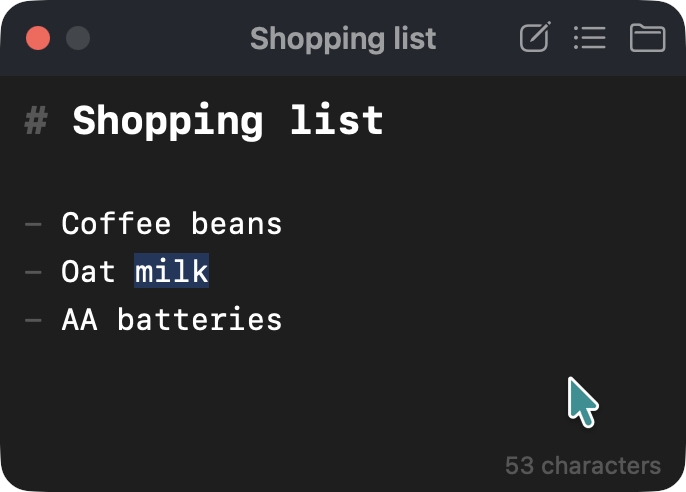

# notepanel

A floating notepad for macOS. Press `Ctrl+Cmd+N` in any app, even one in full screen, and a
note panel appears on top of it. Edits (like VS Code), press `Ctrl+Cmd+N` again (or `Cmd+W`, `Esc`), and you're back in the app you were
using.

Each note is a plain Markdown file in a folder you choose, so you can also open your notes in any
other editor, sync them or back them up as you like.



## Features

- **Opens over everything.** The panel floats above other windows, full-screen apps included, on
  every Space. Showing it doesn't switch apps: the app you were in stays active, and gets the focus
  back when you hide the panel.
- **Edits like VS Code.** The editor is CodeMirror 6 with VS Code's keys: multiple cursors,
  rectangular selection, moving and copying lines, and find and replace. It also highlights
  Markdown and continues lists when you press `Return`.
- **Plain files.** Each note is a `.md` file named after its first line.
- **Hard to lose text.** It saves as you type, never overwrites a file another app changed, and
  keeps earlier versions as backups.
- **Quick to switch notes.** `Cmd+P` searches the names and text of your notes, and
  `Ctrl+Tab` goes to the next one. Pinned notes come first.

## Install

You need macOS 14 Sonoma or later, and Swift 5.10 or later. The Command Line Tools are enough
(`xcode-select --install`); you don't need Xcode. There are no prebuilt downloads yet, so you build
the app yourself:

```sh
git clone https://github.com/kkensuke/notepanel.git
cd notepanel
scripts/bundle.sh                         # builds build/notepanel.app
cp -R build/notepanel.app /Applications/
open /Applications/notepanel.app
```

notepanel lives in the menu bar, as a note icon, and has no Dock icon. The shortcut needs no
Accessibility permission. To start notepanel when you log in, turn on **Open at login** in Settings.

To update, run `git pull` and `scripts/bundle.sh` again, quit notepanel (`Cmd+Q` in the
panel), copy the new app to `/Applications`, and open it.

## Using it

- **Show and hide.** Press `Ctrl+Cmd+N`, or click the menu bar icon. `Esc` or
  `Cmd+W` hides the panel.
- **Notes.** `Cmd+N` starts a new note. `Cmd+P` opens the switcher: type to search,
  then press `Return` to open the note. Each row has a pin button and a trash button.
- **Names.** A note is named after its first line: `# Shopping list` is saved as
  `Shopping list.md`. If another note has that name, a number is added. To choose a name yourself,
  click the name in the title bar; from then on the name stays as you set it.
- **Menu.** Right-click the menu bar icon (or Control-click it) for New Note, Search Notes,
  Settings, Keyboard Shortcuts, the backups folder and Quit. Each item shows its key in the panel.
- **Keys.** `Shift+Cmd+/` in the panel lists all the keys. The list is also in Settings →
  Shortcuts and in the menu bar icon's menu.
- **Size.** The panel keeps the size you give it. `Cmd+Plus` and `Cmd+Minus` change the
  note's text size, and `Cmd+0` resets it.

## Settings

Open Settings with `Cmd+,` in the panel, or from the menu bar icon's menu.

- **General:** the notes folder, the note font (one of the monospaced fonts on your Mac), the size
  of the interface text, whether to show spaces, tabs and full-width spaces, how many spaces the
  Tab key indents by (2 or 4), whether the menu bar icon shows, and Open at login.
- **Shortcuts:** the shortcuts that work from any app (show or hide notes, new note, search notes)
  and the ones that work in the panel (next and previous note). Click a shortcut and press the
  keys. `Esc` cancels, and the × button removes the shortcut.

If you hide the menu bar icon, you can still reach Settings: press `Cmd+,` in the panel, or
open notepanel again from Finder or Spotlight.

## Your notes and their safety

- **Where they are.** Notes are kept in `~/Library/Application Support/notepanel/Notes` unless
  you choose another folder in Settings. notepanel lists the `.md` files at the top of that folder,
  not in subfolders. Choosing another folder doesn't move your notes.
- **Saving.** Text is saved 0.3 seconds after you stop typing, and at once when you hide the
  panel, switch notes or quit. If a save fails, the bottom of the panel says why, the text stays in
  notepanel, and quitting asks before it drops anything.
- **Changes from other apps.** notepanel reads a note again when you show the panel or open the
  note. If the file changed on disk while you had unsaved text, your text goes to a separate copy
  named `… (conflict date time).md`, and the file on disk is left alone.
- **Backups.** Before a save replaces a note, the earlier text is copied to
  `~/Library/Application Support/notepanel/Backups`, at most once every 10 minutes per note.
  Backups older than 30 days are deleted when notepanel starts.
- **Deleting.** Moving a note to the Trash asks first, and you can restore it from the Trash in
  Finder.
- **Other files.** notepanel won't open a file that isn't UTF-8 text, and leaves it unchanged.

## Keys

notepanel shows this list too: press `Shift+Cmd+/` in the panel.

In the panel, Settings and the list of keys:

| Key | Does |
|---|---|
| ⌘, / ⇧⌘/ | Open or close Settings / the list of keys |
| ⌘Q | Quit (it saves first, and asks if something couldn't be saved) |

In the panel:

| Key | Does |
|---|---|
| ⌘N / ⌘P / ⌘O | New note / switch notes / open the notes folder |
| ⌃Tab / ⌃⇧Tab | Next / previous note, pinned notes first (change them in Settings) |
| ⌘+ / ⌘− / ⌘0 | Bigger / smaller / default note text |
| ⌘W, Esc | Hide (Esc first closes search, extra cursors or the switcher) |
| In the switcher: ↑↓, Return, ⌘⌫ | Choose, open, move to the Trash |

Editing:

| Key | Does |
|---|---|
| ⌘⌫ | Delete to the line start; at the start of a line, join it with the line above |
| ⌘← / ⌘→ | Line start (after the indentation first) / line end |
| ⌥↑ / ⌥↓, ⇧⌥↑ / ⇧⌥↓ | Move lines, copy lines |
| ⇧⌘K, ⌘L | Delete line, select line |
| ⌘Return / ⇧⌘Return | Insert a line below / above |
| ⌘D, ⇧⌘L, ⌥⌘↑ / ⌥⌘↓, ⌥-click | Multiple cursors |
| ⇧⌥-drag | Rectangular selection |
| ⌘F, ⌘G / ⇧⌘G | Find and replace, next / previous |
| ⌘-click | Open a link |

## Troubleshooting

- **`Ctrl+Cmd+N` does nothing.** Another app may already use that shortcut. Choose another one in
  Settings → Shortcuts.
- **I need an earlier version of a note.** Right-click the menu bar icon and choose Open Backups
  Folder. Each backup is named with the date and time, then the note's name.
- **Uninstalling.** Turn off Open at login, quit notepanel, and delete
  `/Applications/notepanel.app`. Its settings are
  removed with `defaults delete io.github.kkensuke.notepanel`. The folder
  `~/Library/Application Support/notepanel` holds the backups and, unless you chose another
  folder, your notes: keep it, or move your notes out before deleting it.

## Development

| Path | What it is |
|---|---|
| `Sources/Notepanel` | The app (AppKit): the panel, the menu bar icon, Settings |
| `Sources/NotepanelCore` | Reading and saving notes, with no UI |
| `editor/` | The editor page (CodeMirror 6), built into `web/editor.js` |
| `web/` | The page the panel shows in a web view |
| `docs/design.md` | The design and the feature list (in Japanese) |

Node is needed only to change the editor page. `web/editor.js` is kept in the repository:

```sh
cd editor
npm ci
npm run build   # writes ../web/editor.js
```

Tests:

```sh
swift run NotepanelChecks   # NotepanelCore: saving, conflicts, naming, backups
cd editor && npm test       # editor helpers: search ranking, links, line insertion, counts
cd editor && npm run smoke  # the editor page in headless Chrome, posing as a Mac
```

`NotepanelChecks` is a plain executable of assertions rather than an XCTest target, because XCTest
comes only with Xcode. The smoke test needs Google Chrome; set `CHROME` to its binary if it isn't
in `/Applications`. To inspect the editor page in the running app, enable Safari's Develop menu;
notepanel's page is listed there.

## Credits

notepanel takes the way it opens and its panel from the Notes feature of
[tinycast](https://github.com/abue-ammar/tinycast), and its editing from
[Heynote](https://github.com/heyman/heynote). The editor is [CodeMirror 6](https://codemirror.net).